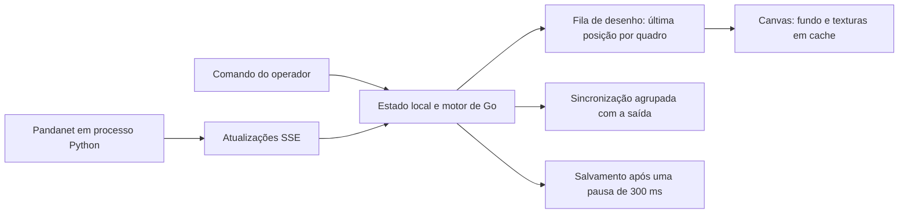

# Responsividade — v0.1.5

A navegação agora altera o estado local e agenda somente o desenho da posição mais recente. Conexão Pandanet, gravação persistente e sincronização da saída não precisam terminar para que o operador veja a posição.

## O que a revisão encontrou

| Caminho anterior | Custo ou risco | Mudança |
| --- | --- | --- |
| `share()` gravava todo o estado em `localStorage` antes de desenhar | Escrita síncrona no caminho de cada clique; custo depende da quantidade de anotações e do navegador | Gravação adiada por 300 ms, com descarga ao sair da página |
| Saída recebia BroadcastChannel e o evento storage | A mesma alteração podia provocar duas renderizações | Um único canal ativo; storage fica como alternativa |
| SVG por tabuleiro, com referências a dezenas de traços por pedra | Milhares de elementos e instâncias gráficas, inclusive nas miniaturas | Canvas com fundo e sprites de pedras em cache; miniaturas com resolução menor |
| Camada de anotação era extraída de um SVG completo temporário | Construção e análise de grade, coordenadas e definições de textura a cada navegação | Pintura direta da camada de indicação e anotações |
| Cada chamada de renderização executava seu trabalho imediatamente | Vários comandos/atualizações podiam desenhar posições intermediárias que nunca seriam vistas | Fila por quadro que mantém o estado mais recente, sem perder o cursor final |
| Launcher reutilizava qualquer servidor Aurora já aberto | Uma atualização podia abrir silenciosamente uma versão anterior | Reuso exige a mesma versão; versões diferentes usam outra porta |

Esses custos foram identificados na implementação. O atraso superior a um segundo relatado pelo usuário não foi reproduzido no teste controlado anterior à mudança; portanto, a revisão não atribui todo o atraso a uma causa única. O usuário confirmou melhora expressiva depois de usar a nova renderização.

## Responsabilidades

- `local-board.js`: regras, cache de posições e variações. Os resultados continuam comparados ao motor Python em 589 casos.
- `frame-queue.js`: agrupa pedidos de desenho. Cem pedidos antes do mesmo quadro produzem um desenho com o último estado.
- `board-painter.js`: desenha o tabuleiro, pedras e anotações em Canvas. As texturas slate and shell são calculadas uma vez por variante e reaproveitadas. O estado de pedras já pintado é reaproveitado quando só mudam as marcações.
- `app.js`: estado da operação, navegação, ferramentas e atualização dos controles. O envio para a saída ocorre em lotes com intervalo de 40 ms; o salvamento ocorre separadamente. Na saída, mensagens sucessivas também são agrupadas por quadro.
- `app.py` e `transport/`: comunicação, perfis e estado recebido. A navegação local não chama `/api/board` nem aguarda o worker de rede.
- `diagnostics.js`: carregado sem ação na operação normal. Em `?diagnostics=1`, oferece medição local de 60 mudanças de posição e restaura a posição inicial ao terminar.

## Comparação controlada

Mesma demonstração com quatro partidas, mesmo navegador integrado e mesmo roteiro de 60 mudanças. São medidas de oportunidade de pintura após dois callbacks de animação; não medem a apresentação física no monitor. O tempo do manipulador não é comparável isoladamente, porque o desenho passou a ser agendado.

| Medida | v0.1.4 SVG | v0.1.5 Canvas | Canvas com saída aberta |
| --- | ---: | ---: | ---: |
| Mediana até a oportunidade de pintura | 31,8 ms | 16,4 ms | 16,6 ms |
| Percentil 95 | 53,2 ms | 17,6 ms | 17,1 ms |
| Máximo | 59,3 ms | 22,6 ms | 23,3 ms |
| Elementos no documento | 5.785 | 242 | 242 |
| Referências SVG `use` | 563 | 0 | 0 |
| Requisições fetch durante navegação | 0 | 0 | 0 |

O observador Event Timing registra eventos reais quando o navegador o suporta. Os comandos do roteiro automático são chamadas locais, e os eventos de clique no relatório correspondem à interação com o botão do teste. Eles não devem ser apresentados como 60 medições de cliques reais.

A versão foi exibida no Safari. A comparação numérica acima foi feita no navegador integrado, não no Safari nem em uma instalação externa do Chrome. Também foi verificada a sincronização com uma janela de saída: operador e saída exibiram a posição 276 da mesma partida, e o retorno à posição final foi preservado. A instância local em uso pelo usuário foi mantida aberta.

## Validação e limites

Passaram 20 testes Python e três conjuntos JavaScript: regras do motor local, anotações/liberdades e fila de desenho. A proteção do launcher tem testes de versão anterior e de versão já compatível. Verificações de sintaxe também passaram.

A conexão remota ainda pode demorar para abrir partidas, mudar salas e recuperar a conexão. Essas operações continuam separadas da navegação local. Multiusuário real, múltiplas ligas e isolamento por conta continuam sendo trabalho futuro; o servidor local ainda possui uma sessão Pandanet compartilhada.
